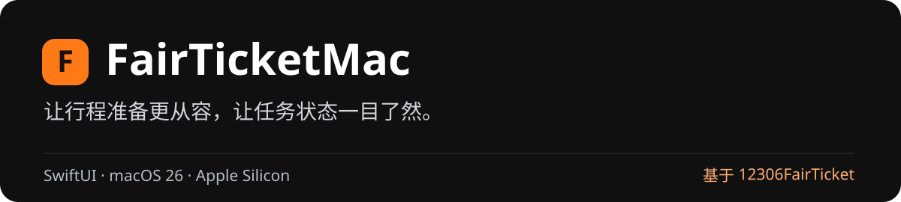
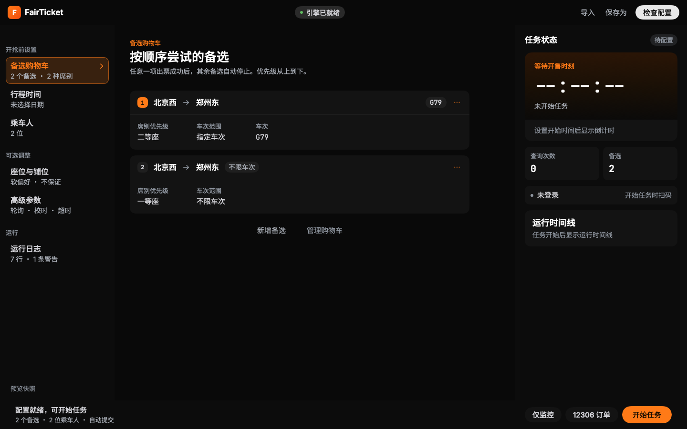
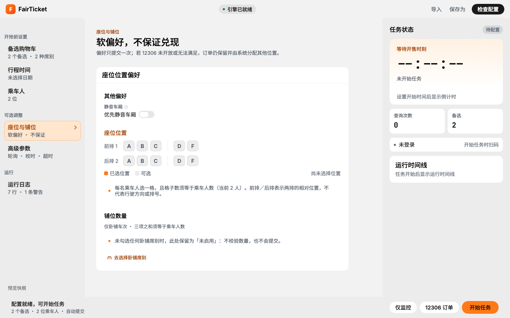
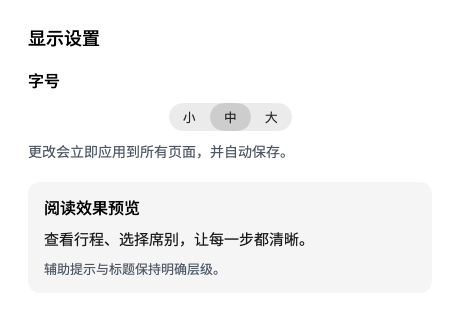
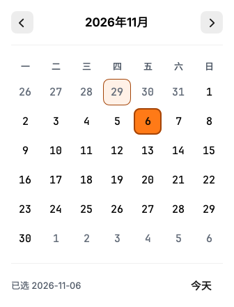

<p align="center"></p>

<p align="center">
<a href="https://github.com/PYFGDUF/FairTicketMac/releases/latest">下载 DMG</a> ·
<a href="#快速开始">快速开始</a> ·
<a href="https://github.com/Tuan-Space/12306FairTicket">原 FairTicket 项目</a>
</p>

**FairTicketMac** 为 12306 购票辅助流程提供 SwiftUI 原生 macOS 界面，集中管理备选车次、乘车人、开始时间与任务状态。

引擎源自 **[Tuan-Space / 12306FairTicket](https://github.com/Tuan-Space/12306FairTicket)**，感谢原作者的工作。本项目提供 macOS 前端、sidecar 集成与应用打包。



## 为桌面使用打磨

- **有顺序的备选**：站点、车次和席别组成购物车，支持添加、移除与优先级调整。
- **清楚的任务状态**：倒计时、扫码登录、命中候选、运行时间线和结果集中呈现。
- **舒适的阅读**：深浅主题、明确的菜单选中状态，以及设置中的小／中／大三档字号。
- **顺手的输入**：站点建议、独立日历、乘车人列表和座位／铺位偏好。
- **原生桌面体验**：菜单栏入口、键盘快捷键和遵循“减少动态效果”的交互动效。



<details>
<summary>查看字号设置与新日历</summary>

<p></p>
<p></p>

</details>

## 快速开始

**系统要求：macOS 26 或更新版本，Apple Silicon（M 系列芯片）。**

1. 从 [Releases](https://github.com/PYFGDUF/FairTicketMac/releases/latest) 下载 `FairTicketMac-1.0.0-macos-arm64.dmg`。
2. 打开 DMG，将 **FairTicketMac.app** 拖入 **Applications**。
3. 添加备选 → 设置日期与时间 → 填写乘车人 → 检查配置 → 确认后开始任务。
4. 按提示扫码登录；成功后前往 12306 官方订单页核对并支付。

程序内置引擎，安装版无需另装 Python。发行包采用 ad-hoc 临时签名，尚未经过 Apple Developer ID 公证；首次打开时可按 macOS 的“隐私与安全性”提示允许打开。

按 **⌘,** 打开设置，选择小、中、大字号；更改即时应用并自动保存。

## 从源码构建

需要支持 macOS 26 SDK 的 Xcode / Swift 6.2 或更新工具链，以及 Python 3.12+（构建内置引擎时使用）。

```bash
git clone https://github.com/PYFGDUF/FairTicketMac.git
cd FairTicketMac
export FAIRTICKET_REPO="$PWD/vendor/12306FairTicket"
./script/build_engine.sh
CONFIG=release ./script/build_and_run.sh --no-launch
open build/FairTicketMac.app
```

构建 DMG：

```bash
./script/package_release.sh
```

## 验证与项目结构

本次发布通过 109 项前端测试，并对深浅主题、三档字号和窄窗口进行了离屏渲染检查；日历键盘选日、字号即时更新与保存也经过本地运行验证。购票结果由余票、网络与 12306 服务决定，请持续留意官方订单状态。

```bash
swift test
```

| 目录 | 内容 |
| --- | --- |
| `Sources/FairTicketUI` | SwiftUI 界面、主题与显示设置 |
| `Sources/FairTicketKit` | 引擎通讯与模型 |
| `Sources/FairTicketMac` | 应用、窗口与菜单场景 |
| `vendor/12306FairTicket` | 对应集成版本的引擎源码与原始文档 |
| `script` | 构建、内置引擎与 DMG 打包 |

## 来源与声明

- **原项目：[Tuan-Space/12306FairTicket](https://github.com/Tuan-Space/12306FairTicket)**，基础版本 v2.1.0。
- 当前引擎集成快照保留 sidecar 适配及已有本地修复，详见 [NOTICE.md](NOTICE.md)。
- 上游代码、字体与第三方组件归各作者所有，保留各自原有许可及声明；见 [来源说明](NOTICE.md)、[字体许可](docs/licenses/) 与 [上游第三方声明](vendor/12306FairTicket/docs/THIRD_PARTY_NOTICES.md)。
- 本项目为第三方辅助客户端。请使用本人账户正常购票；订单核对与支付请在 12306 官方渠道完成。
